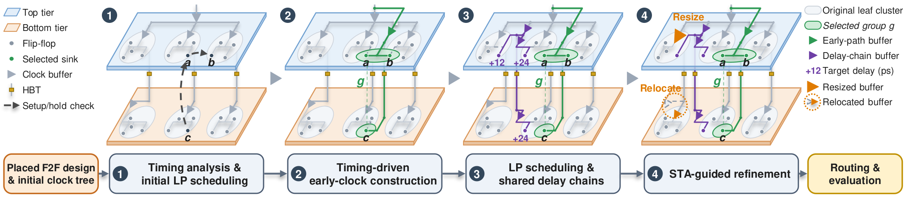

# Useful-Skew Clock Tree Synthesis for Face-to-Face 3D ICs

Clock tree synthesis (CTS) flow for face-to-face (F2F) stacked 3D ICs with hybrid bonding.

<p align="center"></p>

## Overview

The flow is implemented as a patch to OpenROAD and a set of flow scripts. Starting from a placed two-tier design, it

1. builds a balanced 3D clock tree, extracts its register timing graph with OpenSTA and solves a linear program for a
   nonnegative clock delay of each register under hold constraints (useful-skew scheduling);
2. connects the clock pins of registers that need an earlier clock to new leaf buffers on short early-clock paths
   (timing-driven early-clock construction); register placement is not changed;
3. realizes the scheduled delays with delay chains shared by the registers of the same branch driver and destination
   tier, with tap depths chosen by a load-aware delay model (shared delay chains);
4. refines the tree with STA-guided buffer resizing, clock-path reconnection and buffer relocation (clock tree
   refinement).

Method details: [`supplementary/method_details.md`](supplementary/method_details.md).

### Paper sections and source code

The OpenROAD changes are in `openroad/openroad_3dcts.patch`. The files below are under `src/cts/src/` of the patched
OpenROAD tree.

| Method | Source |
|---|---|
| Timing analysis | `TimingGraphExtractor.cpp` (`extractRegisterEdges`) |
| Useful-skew scheduling (LP) | `CtsSkewLpSolver.cpp` (`solveTns`) |
| Early-clock construction | `StagePredictor.cpp`, `EarlyClockCalibration.cpp`, `EarlyClockGroups.cpp`, `EarlyHub.cpp` |
| Shared delay chains, load-aware tap assignment | `HTreeBuilder.cpp` (`buildSharedDelayChains`, `assignLoadAwareTapDepths`) |
| Clock tree refinement | `ClockRefinement.cpp` (`runClockRefinement`); buffer relocation in `flow/cts/tcl/buffer_relocation.tcl` |

## Requirements

Main tools and libraries tested (Linux x86-64); the full dependency setup is in `openroad/deps.example.sh`.

| Tool / library | Version |
|---|---|
| GCC (C++17) | 12.2.0 |
| CMake | 3.25.1 |
| OR-Tools | 9.15 |
| Boost | 1.81.0 |
| Cadence Innovus (`ariane133` routing only) | 21.1 |

## Build

1. Build OpenROAD (upstream commit 0609245c with `openroad/openroad_3dcts.patch`). Dependencies that are not on the
   default search paths go into `openroad/deps.local.sh`.
   ```
   openroad/build_openroad.sh ../OpenROAD-3dcts
   ```
2. Create the site configuration and set `CTS3D_OPENROAD` (and `INNOVUS_EXE` for `ariane133`).
   ```
   cp setup_env.example.sh setup_env.sh
   ```
3. Build the helper programs of the flow, with the same compiler as OpenROAD.
   ```
   flow/cts/native/build.sh
   ```

## Running

1. Run CTS for one case:
   ```
   ./run_cts.sh a7a7_aes
   ```
   `THREADS` (default 16) sets the number of timing-graph extraction processes and the thread count of the OpenROAD
   sessions of a case (some steps use fewer). All ten cases: `./run_cts.sh all -j <N>` (N cases at a time;
   N × THREADS should not exceed the number of cores).
2. Route the CTS result (routing, parasitic extraction and final timing report):
   ```
   ./run_route.sh a7a7_aes
   ```
   Routing uses OpenROAD global and detailed routing (10 detailed-routing iterations, set in `config.mk`;
   `DETAILED_ROUTE_END_ITERATION=<n>` overrides it). The two `ariane133` cases are routed with Cadence Innovus.
   Parasitic extraction (OpenRCX) and the final timing report run in OpenROAD. All cases: `./run_route.sh all -j <N>`.
3. Check the results:

   | File | Content |
   |---|---|
   | `runs/a7a7_aes/cts.log` | run log with the time and memory of each step and the final setup/hold TNS and WNS |
   | `runs/a7a7_aes/OUTPUT/4_cts.{odb,def,v,sdc}` | CTS result used for routing |
   | `runs/a7a7_aes/route/reports/asap7_3D/aes/openroad/6_finish.rpt` | post-route timing, power, area and wire length |

## Benchmarks

The benchmarks comprise ten cases: `aes`, `jpeg`, `ibex`, `swerv_wrapper`, and `ariane133`, each evaluated on two F2F
platforms.

| Case | Platform | Design | Clock period (ps) |
|---|---|---|---:|
| `a7a7_aes` | asap7_3D | aes | 275 |
| `a7a7_jpeg` | asap7_3D | jpeg | 550 |
| `a7a7_ibex` | asap7_3D | ibex | 750 |
| `a7a7_swerv` | asap7_3D | swerv_wrapper | 1200 |
| `a7a7_ariane` | asap7_3D | ariane133 | 750 |
| `a7n45_aes` | asap7_nangate45_3D | aes | 300 |
| `a7n45_jpeg` | asap7_nangate45_3D | jpeg | 450 |
| `a7n45_ibex` | asap7_nangate45_3D | ibex | 1600 |
| `a7n45_swerv` | asap7_nangate45_3D | swerv_wrapper | 1500 |
| `a7n45_ariane` | asap7_nangate45_3D | ariane133 | 2250 |

`asap7_3D` uses ASAP7 on both tiers; `asap7_nangate45_3D` uses ASAP7 on the upper tier and NanGate45 on the bottom
tier. Synthesis, tier partitioning and placement are not included: each case starts from a fixed placed design in
`inputs/<case>/T<period>/` (`3_place.{def,v,sdc}`, checksums in `inputs/SHA256SUMS`), produced with the Pin-3D flow.

## Supplementary material

[`supplementary/`](supplementary/README.md): post-CTS timing, CTS runtime, realization of the scheduled delays and
method details.

## Repository layout

| Path | Content |
|---|---|
| `openroad/` | OpenROAD patch and build script |
| `flow/cts/` | 3D CTS scripts and helper programs |
| `flow/route/` | routing scripts (OpenROAD and Innovus) |
| `flow/common/`, `flow/configs/` | scripts and settings shared by CTS and routing |
| `flow/platforms/`, `flow/designs/` | two-tier platforms and design configurations |
| `inputs/` | placed designs |
| `supplementary/` | supplementary results |
