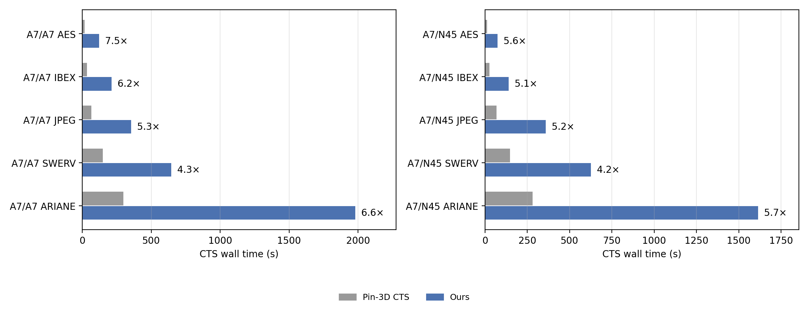

# Supplementary Results

Experiments that are not reported in the paper. All results use the ten cases, placements and clock periods listed
in [Benchmarks](../README.md#benchmarks).

- [Post-CTS timing](#post-cts-timing)
- [CTS runtime](#cts-runtime)
- [Realization of delay targets](#realization-of-delay-targets)
- [Method details](method_details.md)

## Post-CTS Timing

Setup and hold TNS and WNS (ps) of the CTS result of Pin-3D and of our flow. Each CTS result is loaded from its DEF
into OpenROAD with the same platform setup, and the timing is reported with propagated clocks and placement
parasitics.

| Platform | Design | Setup TNS Pin-3D | Setup TNS Ours | Setup WNS Pin-3D | Setup WNS Ours | Hold TNS Pin-3D | Hold TNS Ours | Hold WNS Pin-3D | Hold WNS Ours |
|---|---|--:|--:|--:|--:|--:|--:|--:|--:|
| A7/A7 | AES | -32,486 | -27,923 | -258.7 | -221.3 | -6,061 | -3,644 | -33.4 | -25.0 |
| A7/A7 | IBEX | -1,206,112 | -1,181,743 | -734.5 | -738.4 | -84 | -19 | -26.5 | -4.3 |
| A7/A7 | JPEG | -25,365 | -1,788 | -146.9 | -95.0 | -631 | -1 | -43.5 | -0.7 |
| A7/A7 | SWERV | -692,329 | -632,499 | -1464.2 | -1396.7 | -70,684 | -36,395 | -207.4 | -144.5 |
| A7/A7 | ARIANE | -17,933,798 | -17,762,122 | -1779.4 | -1768.1 | -450,696 | -231,774 | -270.2 | -239.5 |
| A7/N45 | AES | -48,581 | -44,017 | -408.5 | -392.2 | -5,050 | -2,858 | -47.7 | -36.3 |
| A7/N45 | IBEX | -308,610 | -221,796 | -342.5 | -339.2 | -176 | -14 | -23.4 | -5.0 |
| A7/N45 | JPEG | -456,027 | -180,989 | -420.0 | -364.9 | -14,069 | -9,684 | -257.7 | -229.5 |
| A7/N45 | SWERV | -124,962 | -52,665 | -740.6 | -641.5 | -1,396,103 | -143,993 | -634.2 | -401.5 |
| A7/N45 | ARIANE | -1,627,645 | -1,314,368 | -657.8 | -606.0 | -152,106 | -29,425 | -562.1 | -186.0 |

Data: [`data/post_cts_timing.csv`](data/post_cts_timing.csv).

## CTS Runtime

CTS wall time measured on the same server for both flows. Our CTS takes 3.3× to 6.6× the CTS time of Pin-3D.
On a machine with at least 32 cores, THREADS=32 is recommended; the runtimes reported in the paper were measured with
THREADS=32.
Pin-3D runs a single balanced CTS with clock buffers on one tier. Our flow additionally extracts the register timing
graph with STA, solves the scheduling LP, and evaluates early-clock construction and refinement moves with
whole-design STA.

Data: [`data/runtime.csv`](data/runtime.csv).

## Realization of Delay Targets

Delay realization is evaluated after shared delay chain insertion and before refinement. For sink $i$, $a_i$ is the
delay target and $\hat a_i$ the change in late clock latency from the initial tree on which the LP was solved
(including its early-clock paths, if any) to the tree with the shared delay chains. For the requested sinks
$\mathcal R=\{i : a_i > 5\,\mathrm{ps}\}$, the target agreement is

$$
F_{\mathrm{match}} = 100\left(1 - \frac{\sum_{i\in\mathcal R}|\hat a_i - a_i|}{\sum_{i\in\mathcal R}\left(|\hat a_i| + a_i\right)}\right)
$$

This score ranges from 0 to 100 %, penalizes both under- and over-delivery, and equals 100 % only when all
requested targets are matched. The median absolute error $|e_i| = |\hat a_i - a_i|$ expresses the deviation in ps.

| Platform | Design | $\lvert\mathcal R\rvert$ | $F_{\mathrm{match}}$ (%) | median $\lvert e_i\rvert$ (ps) |
|---|---|---:|---:|---:|
| A7/A7 | AES | 118 | 94.2 | 4.4 |
| A7/A7 | IBEX | 775 | 93.9 | 4.4 |
| A7/A7 | JPEG | 450 | 87.8 | 8.0 |
| A7/A7 | SWERV | 1589 | 93.6 | 3.8 |
| A7/A7 | ARIANE | 7287 | 86.3 | 6.7 |
| A7/N45 | AES | 117 | 89.5 | 9.4 |
| A7/N45 | IBEX | 992 | 76.8 | 28.8 |
| A7/N45 | JPEG | 3911 | 85.0 | 16.4 |
| A7/N45 | SWERV | 616 | 84.1 | 14.2 |
| A7/N45 | ARIANE | 3731 | 86.4 | 14.3 |
